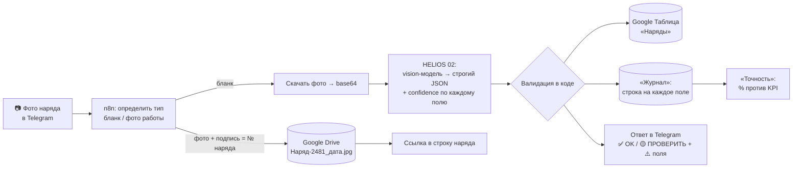
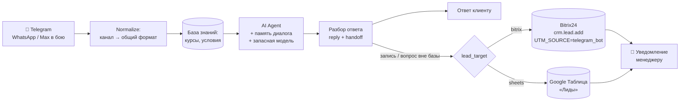

# HELIOS · ИИ-автоматизации (демо)

Две рабочие автоматизации на n8n, повторяющие задачи из плана внедрения HELIOS:

1. **Распознавание бумажных нарядов по фото.** Бот → нейросеть → проверка → таблица. Фото готовых работ уходят в хранилище и привязываются к наряду.
2. **ИИ-консультант учебного центра.** Отвечает по базе знаний, ведёт к записи и передаёт диалог менеджеру (лид в Bitrix24).

Все данные в демо выдуманные. ФИО пациентов не сохраняются нигде, только инициалы (152-ФЗ).

| Workflow | Файл | Что делает |
|---|---|---|
| HELIOS 01 Наряды | `workflows/01-orders-photo-to-sheet.json` | Telegram → распознавание → валидация → Google Таблица, фото работ → Drive |
| HELIOS 02 Распознать наряд | `workflows/02-recognize-order-llm.json` | Единственное место, где живут модель и промпт. Используется ботом и тестами |
| HELIOS 03 ИИ-консультант | `workflows/03-kb-consultant.json` | AI Agent + память + база курсов → ответ клиенту, лид в Bitrix24, уведомление менеджеру |
| HELIOS 99 Ошибки | `workflows/99-error-alerts.json` | Error Workflow: при падении любого из workflow присылает алерт в Telegram |

---

## Проект 1. Наряды по фото

**Поля:** номер, дата, клиника, врач, пациент (только инициалы), зубная формула (FDI), вид работы, количество единиц, цвет VITA, срок сдачи, комментарий. Для каждого поля модель возвращает `confidence` от 0 до 1.

**Проверки в коде.** Это не просьба к модели, а детерминированные правила:

| Правило | Зачем |
|---|---|
| Номер или количество с `confidence < 0.9` → **ПРОВЕРИТЬ** | KPI 98 % для этих полей |
| Остальные поля: `confidence < 0.7` или пусто → **ПРОВЕРИТЬ** | KPI 95 % |
| ФИО пациента принудительно превращается в инициалы, даже если модель вернула фамилию | 152-ФЗ |
| Зубы должны быть корректными номерами FDI (11–18, 21–28, 31–38, 41–48) | защита от «зуба 19» |
| Количество единиц = числу отмеченных зубов | ловит ошибку чтения |
| Цвет должен быть кодом VITA (A1–D4, BL1–4, 3D-Master) | справочник |
| Срок сдачи не раньше даты приёма | здравый смысл |
| Клиника и врач подтягиваются к справочнику (Левенштейн): «Ульябка» → «Улыбка». Незнакомое значение → ПРОВЕРИТЬ | модель уверенно ошибается в 1–2 буквах рукописи |

### Как это закрывает KPI («номер и количество ≥ 98 %, остальное ≥ 95 %, 2 недели параллельно с ручным вводом»)

- **Лист «Журнал»** — одна строка на каждое распознанное поле. Две недели оператор вносит своё значение в колонку «Ручное значение».
- **Лист «Точность»** сам считает процент совпадений по каждому полю и сравнивает с KPI (✅ / ❌). Через две недели это готовый отчёт о том, можно ли отключать ручной ввод.
- **Статус «ПРОВЕРИТЬ»** означает, что спорные наряды не попадают в работу молча: оператор видит подсвеченную строку и ⚠️ на конкретных полях.

**Замер на тестовых нарядах** (`scripts/eval_models.py`, 4 наряда, один нарочно размытый, модель `nvidia/nemotron-3.5-super-vl:free`):

| Номер | Количество | Остальные поля | Размытое фото → ПРОВЕРИТЬ | Фамилия не утекла | ≈ сек/наряд |
|---|---|---|---|---|---|
| 4/4 (100 %) | 3/3 (100 %) | 30/32 (94 %) | да | да | 16 |

Обе ошибки были описками в рукописи («Ульябка», «Киим»). После этого замера добавлен справочник клиник и врачей, который такие ошибки исправляет. Повторный прогон на тестовом наборе после этой правки не делался.

---

## Проект 2. ИИ-консультант с передачей менеджеру

- **Только по базе.** Курсы и условия подставляются в системный промпт целиком: при десятках курсов это надёжнее и дешевле векторного поиска. Запрещено выдумывать цены, даты, лекторов и скидки, а также давать медицинские советы. На «сколько стоит имплантация?» бот отвечает, что учебный центр лечением не занимается, и возвращает разговор к курсам.
- **Передача менеджеру** происходит, когда клиент хочет записаться и назвал имя и телефон, или когда вопроса нет в базе. Лид содержит имя, телефон, курс, резюме диалога и `UTM_SOURCE=telegram_bot`.
- **Смена канала одной нодой.** Про Telegram знают только триггер, нода `Normalize` и нода ответа. Для WhatsApp или Max заменяются они, логика и база знаний остаются.
- **Запасной вариант для лидов.** `lead_target=sheets` в конфиге пишет лиды в Google Таблицу, если Bitrix недоступен.
- **Устойчивость.** У агента есть запасная модель. Если модель сломала JSON, ответ всё равно разбирается, и клиент никогда не видит сырой JSON.

---

## Безопасность и где лежат секреты

| Что | Где | В git / экспорте |
|---|---|---|
| Ключ OpenRouter, токены ботов, Google OAuth | n8n Credentials (зашифрованы ключом n8n) | нет, в JSON только плейсхолдер `REPLACE_CREDENTIAL_ID` |
| Вебхук Bitrix24, chat_id менеджера, ID таблицы и папки, модели | n8n Data Table `helios_config` | нет |
| Локальные переменные | `.env` (в `.gitignore`) | нет |

- Перед коммитом `scripts/sanitize_export.py` заменяет ID плейсхолдерами и ищет в файлах всё, похожее на ключи. Если находит, падает.
- В алертах об ошибках вебхуки, токены ботов и API-ключи маскируются.
- Модель меняется одной строкой в `helios_config` (`llm_model`, `kb_model`), промпт и логика остаются.

---

## Что будет в бою

| Демо | Бой |
|---|---|
| Бесплатные модели OpenRouter, выдуманные данные | Российская модель (YandexGPT / GigaChat) или модель на сервере лаборатории. Данные пациентов не уходят за рубеж |
| n8n на VPS в Германии | n8n на сервере в РФ (Яндекс Облако / Selectel), HTTPS, доступ по VPN |
| Google Таблица + Drive | Смарт-процесс Bitrix24 «Наряды» (стадии: принят → в работе → готов → сдан, фото в поле-файле) или своя БД (Postgres + S3) в РФ |
| Telegram | WhatsApp / Max: замена триггера, `Normalize` и ноды ответа |
| — | Ежедневные бэкапы n8n (БД + workflow в git), мониторинг очереди, алерты в рабочий чат |
| — | Договор поручения обработки ПДн с провайдерами, согласие пациента в бланке, журнал доступа |

---

## Как развернуть

1. **n8n Credentials:**
   - OpenRouter;
   - 2 × Telegram API (бот нарядов и бот консультанта);
   - Google Sheets OAuth2 и Google Drive OAuth2.
2. **Data Tables:**
   - `helios_config` (`key`, `value`) с ключами: `llm_model`, `kb_model`, `sheet_id`, `drive_folder_id`, `manager_chat_id`, `lead_target` (`bitrix` или `sheets`), `bitrix_webhook`, `clinics`, `doctors` (последние два через `;`);
   - `helios_courses` с курсами (структура: `kb/courses.csv`).
3. **Google Таблица** с листами «Наряды», «Журнал», «Точность», «Лиды» (заголовки как в workflow) и **папка на Drive**. Их ID запишите в `helios_config`.
4. **Импорт** `workflows/*.json` и замена плейсхолдеров:
   - `REPLACE_CREDENTIAL_ID`: выберите credential в нодах;
   - `REPLACE_DATATABLE_*`: выберите таблицы в нодах Data Table;
   - `REPLACE_WORKFLOW_*`: укажите под-workflow распознавания и Error Workflow.
5. **Активация:** сначала HELIOS 02 и HELIOS 99, затем 01 и 03.

**Тестовые данные:**
- `python scripts/make_test_orders.py` создаёт бланк для печати и 4 тестовых наряда;
- `python scripts/eval_models.py --url <webhook> --models <id>` замеряет точность модели на этих нарядах.
